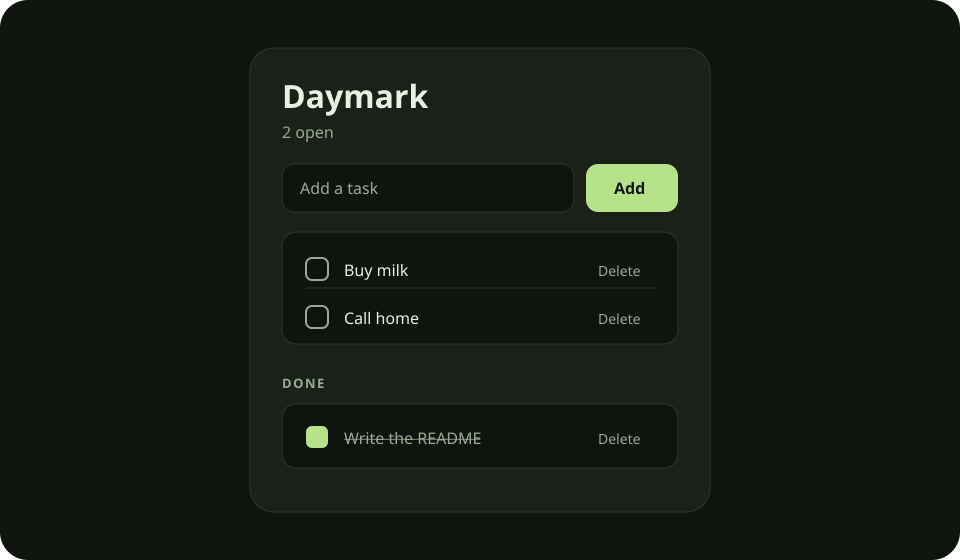

<p align="center">
  
</p>

<h1 align="center">Daymark</h1>

<p align="center">
  A checklist you can install on your phone.<br>
  Add a task, check it off, delete the ones that no longer matter.
</p>

<p align="center">
  
  
</p>

## What it does

| | |
|---|---|
| **Add** | Type a task and it lands at the top of the open list. |
| **Check** | Tap a task to mark it done. Tap it again to bring it back. |
| **Delete** | Each task has its own delete button. Only that task goes away. |
| **Install** | Add it to your home screen. It opens like an app, with its own icon. |

Tasks stay on the device you installed it on.

## Run it here

```bash
npm install
npm run dev
```

Open http://localhost:3000.

## Put it on a phone

Deploy the repository on Vercel with the Next.js preset. Then open the site in the phone browser.

- **Android, Chrome:** menu, then Install app or Add to Home screen.
- **iPhone, Safari:** Share, then Add to Home Screen.

## Project

```
app/            the checklist
public/         icon, manifest, service worker
engine/         optional local command line and SQLite store
docs/           the picture at the top of this page
```

The phone app keeps its own list. The engine is for this computer:

```bash
python3 -m venv .venv
.venv/bin/pip install -r engine/requirements.txt
.venv/bin/python -m engine.cli add --list Inbox "Buy milk"
.venv/bin/python -m engine.cli tasks
.venv/bin/python -m pytest engine/tests -q
```
